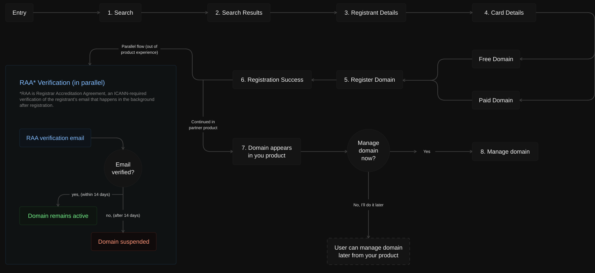
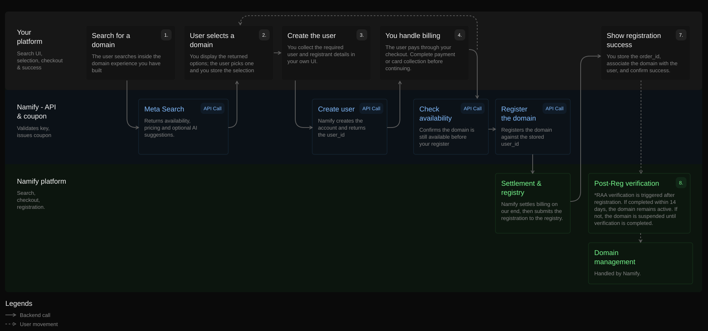
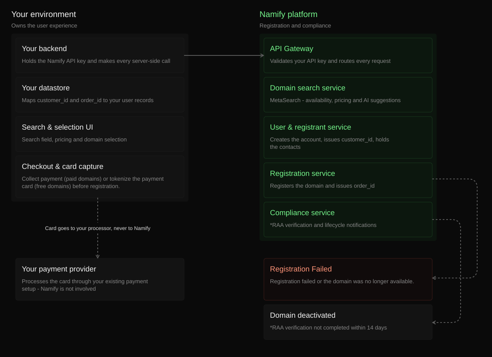

## What is the hybrid integration?

The hybrid approach lets your users search, select, and purchase domains within your platform, while Namify handles registration, support, and compliance behind the scenes. Your users can access domain management through your product, with the underlying management experience handled by Namify.

In the Partner Billing model, you own the checkout and billing experience. You integrate with Namify APIs for domain search, user creation, availability checks, and registration.

## Who is it best suited for?

The hybrid integration is a good fit if you:

* Want domain selection to feel like a native part of your product.
* Want control over the search, selection, checkout, and post-purchase experience.
* Are comfortable integrating with Namify APIs.
* Don't want to build or manage the underlying domain-registration infrastructure.
* Need flexibility over who handles user billing.

## Journey at a glance

The user searches for a domain, selects it, provides the required registrant details, and completes the applicable billing step within your product. Namify registers the domain, and you reflect the successful registration in your product. RAA email verification happens in parallel after registration.

## Step 1: Search for a domain

The user starts their domain search directly within your platform.

### Send the search to Namify

The user enters a name or domain into the search experience on your product. Your backend calls the [MetaSearch API](https://docs.namify.tech/api-reference/domains/metasearch):

`GET /v1/search`

The same request can also return automatic or AI-generated domain suggestions.

### Display the search results

Namify returns domain options and availability, hero spot TLD, registration and pricing, and domain suggestions if requested.

Your search results should include:

* Domain name and availability.
* Registration price, including any promotional pricing.
* Renewal price, clearly displayed.
* A clear Select or Register CTA for each domain.
* Hero placement for the primary domain recommendation, where applicable.

See the [MetaSearch demo](https://protos.namify.tech/metasearch) for guidance on implementing the search results experience.

## Step 2: User selects a domain

The user selects the domain they want from the search results. For example, a user may select `mybrand.store` after viewing its availability and annual price.

Store the selected domain and carry it forward into the registration journey. At this stage, the domain has not yet been registered.

## Step 3: Create the user

Before the domain can be registered, the user must be created on Namify.

### Collect the required user details

If you already have this information, you can reuse it. Otherwise, collect the following details:

- First name
- Last name
- Email
- Address
- State
- Country
- PIN / ZIP code
- Phone number with country code

### Create the user on Namify

Your backend calls the [Create User API](https://docs.namify.tech/api-reference/customer/signup):

`POST /api/v1/users/signup`

Send the required user and registrant details in this request. Namify creates the user and returns a unique `customer_id`.

Store the `customer_id` and use it during the registration call.

## Step 4: Complete the billing step

In the Partner Billing model, you handle billing through your own checkout experience.

### For a paid domain

The user completes payment through your billing experience. Registration can continue only after payment succeeds.

### For a free domain

There is no upfront payment for the domain itself. You collect and tokenize the card as part of your own billing flow to activate domain auto-renewal, where required by the agreed flow.

## Step 5: Check domain availability

Before registration, check the selected domain again to confirm that it is still available.

Your backend calls the [Availability API](https://docs.namify.tech/api-reference/domains/availability):

`GET /api/v1/domains/availability`

Namify returns the latest availability:

- **If available:** Continue to the Register Domain step.
- **If unavailable:** Do not submit the registration request. Ask the user to select another domain.

## Step 6: Register the domain

Once the required user details are available, domain availability has been reconfirmed, and any required billing step is complete, the domain can be registered.

### Send the registration request

Your backend calls the [Registration API](https://docs.namify.tech/api-reference/domains/registration):

`POST /api/v1/domains/register`

Register the selected domain against the previously created `customer_id`.

### Receive the registration result

Namify submits the registration to the registry. The contact information provided when creating the user is used as the domain's registrant, admin, technical, and billing information.

On successful registration, Namify returns:

- `status: SUCCESS`
- `order_id`

Store the `order_id` against the registered domain.

## Step 7: Show registration success

Once Namify confirms successful registration, reflect that result within your product.

The successful response comes from the same [Registration API](https://docs.namify.tech/api-reference/domains/registration) call. No additional API call is required.

Associate the registered domain and `order_id` with the correct user. Only show the domain as successfully registered after Namify confirms that registration has completed.

## Step 8: Post-registration verification

After registration, mandatory RAA verification is triggered. As part of ICANN-required registrant email verification under the Registrar Accreditation Agreement (RAA), Namify sends the user a verification email.

The user must click the button in the email and verify their email address within 14 days.

- **If verified within 14 days:** The domain continues functioning normally.
- **If not verified within 14 days:** The domain is suspended until verification is completed.

## Swimlane diagram

The swimlane below shows how the user journey and backend calls are distributed across your platform, Namify APIs, and the Namify platform.

## System diagram

The system diagram below shows how your environment, payment provider, and the Namify platform interact. You handle payment and card collection through your existing payment setup, while Namify handles registration and compliance.

## Ownership summary

### You own

**User experience**

- Build the domain search, selection, checkout, and purchase experience within your platform.
- Display domain availability, pricing, and suggestions returned by Namify.
- Show registration success or failure.
- Provide an entry point to domain management after registration.

**API integration**

- Call the MetaSearch API.
- Collect the required user and registrant details.
- Call the Create User API and store the returned `customer_id`.
- Re-check domain availability before registration.
- Call the Register Domain API and store the returned `order_id`.

**Billing**

- Collect and process payment for paid domains.
- Handle card collection and tokenization for free domains where required by the agreed flow.
- Handle auto-renewal billing.

### Namify owns

**Domain platform**

- Return domain availability, pricing, and suggestions.
- Create the user and return the `customer_id`.
- Register the domain with the registry.
- Return the registration result and `order_id`.

**Post-registration**

- Provide the underlying domain-management experience.
- Handle DNS and other domain-management operations.
- Send and manage RAA email verification.
- Suspend the domain if RAA verification is not completed within 14 days, and restore it once verification is completed.

### Shared responsibility

- Ensure the registration request contains all required user and registrant information.
- Ensure the user is aware of any outstanding post-registration action, including RAA verification.

## Managing the domain post-purchase

After registration, the domain should remain visible and accessible within your product.

### Display the registered domain

Show the domain in your user's account, along with its registration status, expiry date, and renewal information.

### Provide a Manage Domain entry point

Add a Manage Domain button that takes the user directly to the relevant Namify domain-management experience.

### Keep domain management with Namify

Your users can access domain management through your product, while Namify handles the underlying functionality, including DNS settings and other domain-management operations.

See the [domain management demo](https://protos.namify.tech/dmdemo) for guidance on displaying registered domains and providing access to domain management within your product.

## What if something goes wrong?

Handle failures at the stage of the Hybrid journey where they occur.

| Failure | What you should do |
| --- | --- |
| Search or availability request fails | If Namify does not return the required domain data, do not allow the user to proceed with that domain. Show an appropriate error and allow them to retry. |
| User creation fails | If no `customer_id` is returned, do not proceed to registration until user creation succeeds. |
| Paid-domain payment fails | Do not proceed to registration. The user must successfully complete payment before the domain can be registered. |
| Free-domain card collection fails | If your implementation requires card collection before registration, keep the user in the card-collection step until it succeeds. |
| Domain is no longer available | Ask the user to select another domain. Do not submit the registration request for an unavailable domain. |
| Registration fails | Show the appropriate failure state and allow the user to retry or select another domain. |
| RAA verification is not completed | The user must verify their email within 14 days. If they do not, the domain is suspended until verification is completed. |
